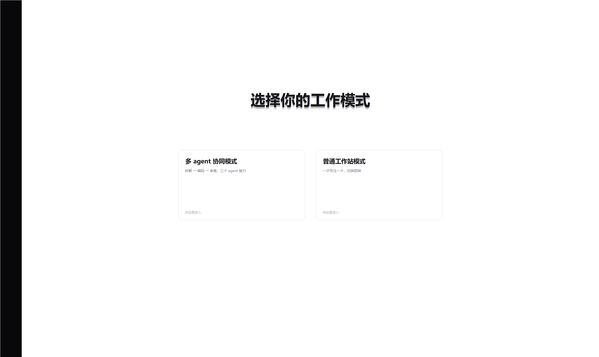

# AGENT HUB

**把一堆 AI 应用收进一条侧栏，一个窗口里切来切去。**

不是网页聚合器——它接管的是**应用本身真实的窗口**，所以登录态、正在跑的任务、没保存的草稿全都在。



---

## 它解决什么

日常要在豆包、Trae、Qoder、Codex、DSH 之间来回切，窗口越开越多，Alt+Tab 里全是它们。

AGENT HUB 换一种用法：**左边一条 92px 的窄栏列着你的应用，点谁就把谁铺到右边**。切换只是显示/隐藏，不重启、不丢状态。

- 同时最多「已选」**3 个**应用，点一下切过去，再点一下换回来
- 侧栏不抢内容区：**关掉窗口就滑到屏幕左边**，碰一下左边缘 3px 或点托盘图标就回来
- 启动时图标像一叠卡片依次展开；**谁被用过就自动浮到最上面**
- 退出时结束所有已选应用，不留后台；下次启动自动恢复上次的三个

## 两种模式

点侧栏底部的「协」或首页卡片进入，二选一。**同一时刻只有一个模式在跑**——切模式会把另一边的应用关掉。

| | 普通工作站模式 | 多 agent 协同模式 |
|---|---|---|
| 目标 | 专注一个应用 | 三个 agent 接力完成一个任务 |
| 界面 | 应用窗口铺满内容区 | 自有面板：任务输入、阶段卡片、对话记录、轮次 |
| 切换 | 点侧栏图标 | 卡片上「确认 → 交给…」逐步推进 |
| 适合 | 日常随时用 | 一个需求从想法走到可验收的代码 |

## 快速开始

**用现成的**：从 [Releases](https://github.com/mihayoufamily/agenthub/releases) 下载 `AgentHub-1.0.0-win64.zip`，解压双击 `AgentHub.exe`。

- 不需要装 .NET SDK，不需要任何运行时，单文件不到 500KB
- 首次运行是模式选择页 + 空侧栏，点底部「+」添加应用：**可以从当前打开的窗口里挑**，也可以手填 exe 路径
- 添加的应用写进同目录 `custom.json`，不污染 `agents.json`

**从源码编**：双击 `build.bat`（用 Windows 自带的 .NET Framework 4 编译器）。

> `bin/` 是构建产物、不进 git，所以**直接下源码 zip 是找不到 exe 的**——要么下 Release，要么自己编。

## 操作

| 操作 | 效果 |
|---|---|
| 左键点图标 | 未选 → 选入并显示；已选 → 切过去 |
| 右键点图标 | 取消 / 编辑 / 移除（后两项只对自己添加的应用） |
| `Alt` + `1`~`9` | 等同左键点第 N 个 |
| 鼠标碰屏幕最左缘 3px | 侧栏滑出后唤回 |
| 底部虚线「+」 | 添加应用 |
| 电源图标 | **关到后台**：侧栏滑出、应用隐藏、进程继续跑 |
| 托盘图标 | 左键唤回；右键「显示 / 重新加载 / 打开日志 / 退出」 |
| 底部「协」 | 进入 / 退出协同模式 |

## 名额：最多三个

判定标准是**进程存活**，不是"点过就算"：

- 选满三个后再点第四个 → 底部弹一条提示，不打断你
- 右键「取消」= 结束整棵进程树 + 释放名额
- 应用自己关掉窗口（包括缩进托盘）→ 2 秒内自动释放名额

## 多 agent 协同

三个应用各司其职，走完一轮「拆解 → 执行 → 自检 → 对齐」：

```
                  ┌────────── 回到 1（算新一轮，须你确认） ──────────┐
                  │                                                    │
需求 →[① 拆解]→[② 执行]→[③ 自检]→[① 对齐：总结/剩余问题/下一轮建议]
         Agent 1     Agent 2     Agent 3             Agent 1
```

**一轮怎么走：**

1. **选角色**：点侧栏选三个应用——第 1 个负责拆解和最终对齐，第 2 个执行，第 3 个自检
2. **填需求**：上方多行输入框，点「开始协同」创建会话（空需求会明确提示，不会误启动）
3. **接力**：程序切到对应应用 + 把阶段提示词放进剪贴板，你 `Ctrl+V` 回车；在应用里 `Ctrl+C` 复制回复，程序自动捕获推进（捕获不到就点「手动推进」）
4. **步级确认**：某步完成后卡片变绿出现「确认 → 交给…」；开了 `autoAdvance` 则跳过逐步确认
5. **轮末必停**：对齐完成才计一轮，随后必须你点「继续下一轮 / 补充需求后继续 / 结束协同」，**绝不自动循环**；下一轮自动带上原始需求、此前成果、自检问题、对齐结论和你的补充
6. **看对话**：点卡片打开该应用的对话窗，记录里是它真实回复过的内容；你输入的补充会注明来源，下次交接时真实进入提示词
7. **失败与停止**：启动失败或超时就停在原处展示原因，可「重试当前步」或「结束协同」；「停止」随时可恢复

会话记录在右侧面板和 `.scratch\pipeline-<时间>.md` 都保留。

## 配置

`agents.json` 是内置应用列表（`agents.example.json` 是模板）：

```json
{
  "id": "doubao",
  "name": "豆包",
  "short": "豆",
  "kind": "exe",
  "exe": "C:\\Path\\To\\Doubao.exe",
  "proc": "Doubao",
  "title": "豆包",
  "frame": "offset"
}
```

| 字段 | 说明 |
|---|---|
| `exe` | 可执行文件，也可写 `.lnk` 快捷方式 |
| `proc` | 进程名，多个用逗号分隔 |
| `title` | 窗口标题包含该串也算命中（进程名拿不到时的兜底） |
| `frame` | 省略 = 去掉标题栏；`offset` = 保留边框、把非客户区推到屏幕外（WebView2 / Tauri 类窗口用它） |

`pipeline.json` 是协同流程定义，首次进协同模式时自动生成，之后每次进入都重读：

| 字段 | 说明 |
|---|---|
| `maxRounds` | 安全上限，达到后「继续」拒绝，只能结束 |
| `stepTimeoutMinutes` | 某步超过这么久没动作就自动暂停 |
| `autoAdvance` | 步级接力是否自动确认；**轮级永远停在用户确认处** |
| `steps` | 四个阶段的提示词；占位符 `{{task}}` `{{decomposition}}` `{{execution}}` `{{selfcheck}}` `{{history}}` `{{additions}}` |

## 出问题时

日志在 exe 同目录 `data\app.log`（`--config` 启动的实例在 `data-<配置名>\`），关键行：

```
start doubao                  ← 点了哪个
found doubao hwnd=...         ← 找到的窗口（标题兜底命中时会打，可核对有没有认错）
find: title match rejected ...← 标题兜底拦掉了一次疑似误匹配
apply ... offset=False        ← 开始接管
apply rejected: ...           ← 窗口拒绝被移动，want= 是期望位置
park 0 ok=True ...            ← 协同模式把窗口停到虚拟桌面外
drop dsh window-gone          ← 应用自己关掉了，已释放名额
```

- 窗口被留在半接管状态（程序异常退出）：`AgentHub.exe --restore`
- 环境自检：`AgentHub.exe --doctor`
- 端到端自检：`powershell -ExecutionPolicy Bypass -File qa.ps1`（另起隔离目录跑一遍主要流程）

## 已知限制

- **只支持 Windows**（依赖 `SetWindowPos` / 窗口样式 / 进程树操作）
- 应用以管理员权限运行时，本程序需要同等权限才能接管它的窗口
- 个别应用会拒绝被移动、或自己抢回窗口尺寸（表现为铺不满）
- 只接管**顶层窗口**，不接管浏览器标签页
- 侧栏和内容区只出现在**主显示器**
- 协同模式靠剪贴板接力：程序只切窗口、放提示词，粘贴、回车、复制回复仍要手动——这是"不入侵应用、不依赖 API"的代价
- 不建议同时开两个实例：不同 `--config` 的数据目录已隔离，但全局热键归先启动的那个

## 结构

```
agenthub/
├─ src/*.cs            源码（WinForms，无第三方依赖，约 8 千行）
├─ build.bat / .ps1    编译脚本（.NET Framework 4 的 csc，无需 SDK）
├─ qa.ps1              端到端自检脚本
├─ icon.ico            应用图标（多尺寸）
├─ agents.example.json 应用配置模板
├─ GLOSSARY.md         领域术语表
├─ docs/adr/           架构决策记录
└─ docs/specs/         功能规格
```

关键决策都留了 ADR：名额制、侧栏只占自身宽度、侧栏滑出、运行期数据按实例隔离。
